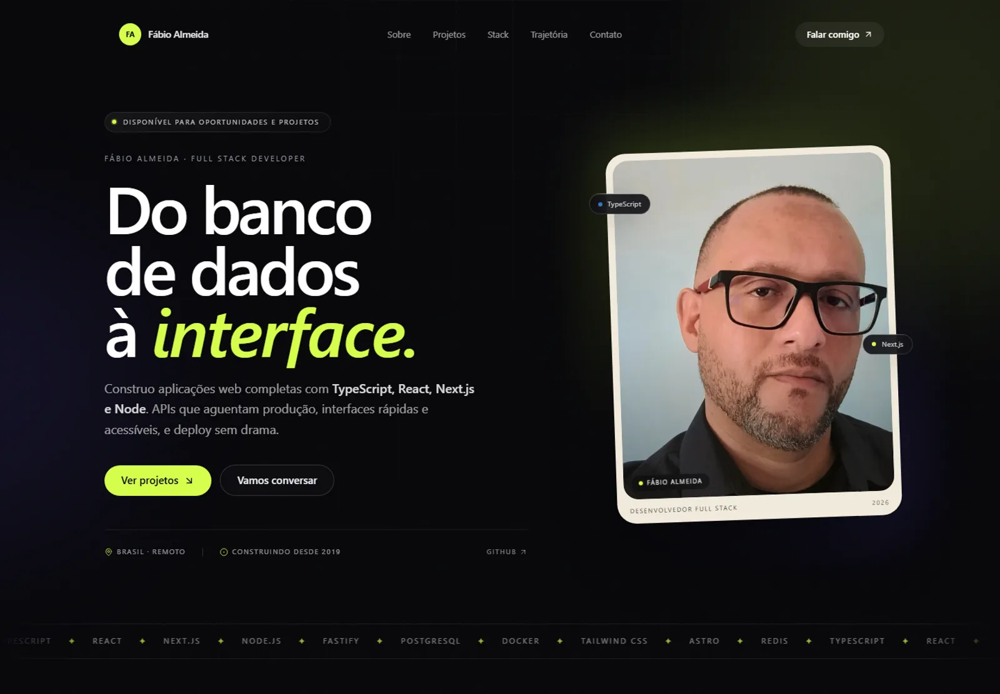

# Fábio Almeida - Portfólio

Portfólio pessoal em **Next.js 16**, **TypeScript** e **Tailwind CSS 4**. Uma página só, com apresentação, projetos em destaque, stack, trajetória e contato.

**[almeidafabio-portifolio.vercel.app](https://almeidafabio-portifolio.vercel.app)**



## O que tem no site

- **Hero** - posicionamento, disponibilidade, retrato e atalhos para projetos e contato
- **Sobre** - trajetória, o que eu faço e o que estou estudando agora
- **Projetos** — quatro destaques com prévia real dos sites, mais três projetos em lista
- **Stack** - tecnologias agrupadas por área, com o que está na fila de aprendizado
- **Trajetória** - linha do tempo de 2019 a 2026, incluindo a graduação em ADS
- **Contato** - e-mail, WhatsApp, LinkedIn e GitHub, com botão de copiar e-mail

## Stack

| | |
|---|---|
| Framework | Next.js 16 (App Router, Turbopack) |
| Linguagem | TypeScript |
| Estilo | Tailwind CSS 4, com design tokens em CSS |
| Fontes | Geist, Geist Mono e Instrument Serif via `next/font` |
| Ícones | lucide-react + SVGs próprios das marcas |
| Imagens | `next/image`, com prévias em WebP |
| Deploy | Vercel |

Sem biblioteca de animação: os reveals usam `IntersectionObserver` e o restante é CSS. O site respeita `prefers-reduced-motion`.

## Rodando localmente

Requer Node.js 20 ou superior.

```bash
npm install
npm run dev
```

Abre em `http://localhost:3000`.

Para conferir a build de produção:

```bash
npm run build
npm start
```

## Editando o conteúdo

Quase tudo que muda de tempos em tempos está em **`src/data/site.ts`**:

| O que mudar | Onde |
|---|---|
| Nome, e-mail, WhatsApp, LinkedIn, GitHub, localização | objeto `site` |
| Projetos em destaque | array `projects` |
| Outros projetos (lista menor) | array `otherProjects` |
| Stack e "aprendendo agora" | `stack` e `learning` |
| Linha do tempo | array `milestones` |
| Links do menu | array `navLinks` |

Os textos das seções (hero, sobre, contato) ficam nos componentes em `src/components`.

### Adicionar um projeto

```ts
{
  slug: "meu-projeto",
  title: "Meu Projeto",
  year: "2026",
  summary: "Uma frase explicando o problema e a solução.",
  tags: ["Next.js", "TypeScript"],
  repo: "https://github.com/AlmeidaFabio/meu-projeto",
  live: "https://meu-projeto.vercel.app",
  image: "/projects/meu-projeto.webp", // opcional
  featured: true,
}
```

Sem `image`, o card usa uma capa tipográfica gerada por CSS. Basta colocar a imagem em `public/projects/` com proporção **16:10** (recomendado: 1600×1000, WebP).

### Trocar a foto

Substitua `public/perfil-2026.webp`. O retrato aparece em um cartão claro inclinado no hero — funciona melhor com fundo neutro e enquadramento do busto para cima.

### Cores e tipografia

Os tokens estão no bloco `@theme` de `src/app/globals.css`:

```css
--color-ink: #07070a;
--color-accent: #d6ff4b;
--color-cream: #f1ebdc;
```

### Domínio e SEO

Defina a URL pública em `.env.local` (ou nas variáveis da Vercel):

```bash
NEXT_PUBLIC_SITE_URL=https://seu-dominio.com
```

Ela alimenta `metadataBase`, sitemap, robots e canonical. A imagem de Open Graph é gerada em `src/app/opengraph-image.tsx` e já usa essa URL.

## Estrutura

```
src/
  app/
    layout.tsx          fontes, metadata, JSON-LD, header e footer
    page.tsx            composição das seções
    globals.css         tokens, componentes e animações
    opengraph-image.tsx imagem 1200×630 gerada no build
    icon.svg            favicon
    sitemap.ts robots.ts
    not-found.tsx       404
    _fonts/             TTFs usadas na imagem de Open Graph
  components/
    header, hero, marquee, about, projects, project-cover,
    stack, timeline, contact, contact-actions, footer,
    reveal, scroll-progress, section-label, brand-icons
  data/
    site.ts             todo o conteúdo editável
public/
  perfil-2026.webp
  projects/             prévias dos projetos (WebP)
```

## Acessibilidade e performance

Última auditoria do Lighthouse (build de produção, mobile):

| Categoria | Nota |
|---|---|
| Performance | 93 |
| Acessibilidade | 100 |
| Boas práticas | 100 |
| SEO | 100 |

O que está implementado:

- HTML semântico, um `h1` por página e landmarks (`header`, `main`, `footer`, `nav`)
- Link "Pular para o conteúdo", foco visível e contraste AA nos textos
- `prefers-reduced-motion` desliga reveals, marquee e animações
- Imagens com `sizes`, `alt` e formatos modernos
- Open Graph, Twitter Card, JSON-LD (`Person`), sitemap e robots

## Deploy na Vercel

1. Suba o projeto para um repositório no GitHub.
2. Importe o repositório em [vercel.com/new](https://vercel.com/new).
3. Adicione `NEXT_PUBLIC_SITE_URL` com o domínio final.
4. Deploy.

Ou pela CLI:

```bash
npx vercel --prod
```

Para usar um domínio próprio, configure o DNS na Vercel e atualize `NEXT_PUBLIC_SITE_URL`.

## Licença

Conteúdo pessoal (textos, foto e marca) - todos os direitos reservados. O código pode ser usado como referência.